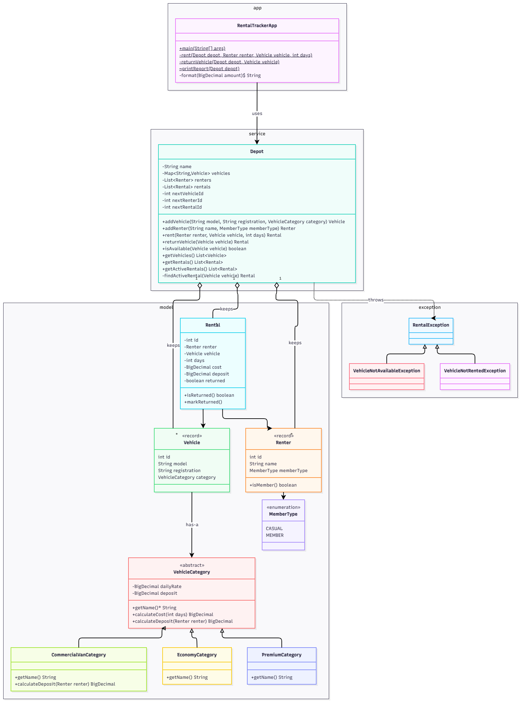

# Dovewing Car Rentals: Diagnosis

Written before any change to the starter code. Design changes made during the build are explained in the design notes in `README.md`.

---

## 1. Problems found

### F1. Critical: a rented vehicle can be rented again (double booking)

- **What:** `Depot.rent()` sets `v.status = "RENTED"` but never checks the status first. The starter's own demo rents the Toyota Vitz to Kofi and then to Ama. Both rentals succeed, and the report shows two active rentals for `GT-1234-20`.
- **Root cause:** Availability is stored twice, in `Vehicle.status` and in each `Rental.status`. No one owns that fact, and nothing keeps the two copies in agreement.
- **Business risk:** One car can be promised to two customers, and one of them is left at the desk with no car. Records no longer match the yard, which is why staff keep a paper backup.

### F2. Critical: a return isn't tied to a single rental

- **What:** `returnVehicle()` closes *every* active rental whose registration matches. Returning a car that isn't rented out also "succeeds".
- **Root cause:** This is the same duplicated state as F1. Rentals are found by string matching, not by identifying the one rental being closed.
- **Business risk:** Returning Kofi's Vitz would silently close Ama's conflicting rental as well, hiding the double booking. A wrong return goes unnoticed.

### F3. High: no encapsulation

- **What:** All fields are public. `getRentals()` returns the internal list, and `Renter.history` is a public, mutable list.
- **Root cause:** The classes expose their data instead of protecting their own rules.
- **Business risk:** Any code can write `v.status = "AVAILABLE"` or edit a rental record directly, bypassing even a correct `rent()`. Fixing F1 in one method isn't enough while this remains.

### F4. High: categories, renter types and statuses are free-text strings

- **What:** A vehicle created with `"Premium"` instead of `"PREMIUM"` matches neither branch in `rent()`. Cost and deposit stay at 0 and the car stays AVAILABLE, yet an active rental is still recorded.
- **Root cause:** The compiler can't check meaning carried in strings, and unknown values aren't rejected.
- **Business risk:** A typo hands out a free rental and creates another available-and-rented contradiction, with no error.

### F5. High: vehicle-class rules are copy-pasted inside `Depot.rent()`

- **What:** The ECONOMY and PREMIUM branches are identical apart from the string they test.
- **Root cause:** Rules that differ by vehicle class live in the one method every class runs through, instead of with the class they belong to.
- **Business risk:** This is how a premium pricing change broke economy handling. Adding the commercial van, with its own deposit rules, would mean a third branch in the same method and retesting everything.

### F6. Medium: no validation

- **What:** The code accepts zero or negative days (giving a zero or negative cost), negative rates, nulls, duplicate registrations, and renters or vehicles the depot doesn't know about.
- **Business risk:** Wrong charges and invalid records.

### F7. Medium: `Depot` does everything, in one file

- **What:** Fleet, renters, pricing, state changes, records and console printing are all in one class, in the default package.
- **Business risk:** The rules can't be tested without capturing console output, and any change risks unrelated behaviour.

### F8. Medium: rentals copy strings instead of referencing objects

- **What:** `Rental` stores `renterName` and `vehicleReg`, and `Renter.history` repeats the same facts a third time.
- **Business risk:** Two renters with the same name can't be told apart, and the copies can drift apart.

### F9. Low: money stored as `double`; static ID counters

- **What:** Floating-point values can't hold many decimal amounts exactly. The static counters are shared by every `Depot` and aren't thread-safe.
- **Business risk:** Rounding errors once rates have decimals. Duplicate IDs with more than one depot or with concurrent use.

---

## 2. The most dangerous problem

**F1, together with its root cause: duplicated state that nobody owns.**

The depot sells one thing: guaranteed use of a specific car for specific days.

- A pricing error can be fixed with a refund.
- A double booking fails a customer in person and destroys trust in the tool. That loss of trust is already showing in the paper backup.

F3 and F4 rank next because they are how F1 would come back even after a fix.

---

## 3. Planned structure

- **One source of truth.** `Depot` keeps a single map of active rentals, keyed by registration. A vehicle's status is derived from that map, never stored, so a car can't be both available and rented, or rented twice.
- **Vehicle classes as composition.** A `Vehicle` *has* a `VehicleCategory` that supplies its cost and deposit rules. Adding the commercial van means adding one new category class, with nothing existing touched.
- **Records and enums** replace public fields and free-text strings. **Exceptions** reject invalid operations before anything changes, and all printing moves out of `Depot`.
