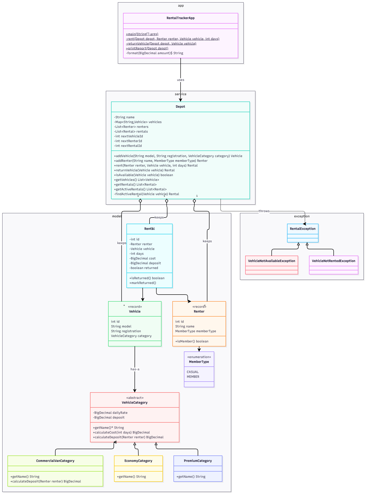

# Dovewing Car Rentals

A rebuild of the single-file `RentalTracker` program left behind at the Dovewing depot.

- **`DIAGNOSIS.md`**: what was wrong with the original and the first design sketch. It was committed before any code change.
- **This README**: how to run the rebuild, its final structure, and the design notes.

## Run it

You need Java 21 and Maven.

```bash
mvn test                                        # run the tests
mvn package                                     # build the jar
java -jar target/dovewing-car-rentals-1.0.0.jar # run the demo day
```

## Structure



| Package | Classes | Job |
|---|---|---|
| `java` | `RentalTrackerApp` | Runs the demo day and does **all** the printing |
| `service` | `Depot` | Keeps the vehicles, renters and rentals, and enforces the rules |
| `model` | `Renter`, `Vehicle`, `Rental`, `MemberType`, `VehicleCategory`, `EconomyCategory`, `PremiumCategory` | The data, and the pricing and deposit rules |
| `exception` | `RentalException`, `VehicleNotAvailableException`, `VehicleNotRentedException` | Requests the depot refuses |

---

## Design notes

### 1. The rule that must never break

> A vehicle is available or rented, never both, and never has more than one active rental.

The original stored this fact twice, once on the vehicle (`status`) and once on each rental (`status`), and nothing kept the two in agreement. The rebuild stores it **once**:

- `Vehicle` has **no status field**.
- Each `Rental` has a `returned` flag. The depot's `rentals` list is the only record of who has which car.
- `Depot.isAvailable(vehicle)` works the answer out from that list every time it is asked. It is never stored.
- `rent()` is the only way to add a rental. It refuses a car that already has an unreturned rental.
- `returnVehicle()` is the only way to close a rental. It refuses a car that is not out.
- Every field is private and the getters return copies, so no other code can change the records behind the depot's back.

**Considered and rejected:** keeping `isAvailable` on `Vehicle` and updating it alongside the rental. That keeps two facts that must agree, which is exactly the root cause of the original bug.

### 2. Vehicle classes: an abstract class with one subclass per class of vehicle

`VehicleCategory` holds a vehicle class's daily rate and deposit, plus two rules:

- `calculateCost(days)`: daily rate × days.
- `calculateDeposit(renter)`: casual renters pay the deposit, members pay nothing.

`EconomyCategory` and `PremiumCategory` extend it and only supply their name. `Depot.rent()` just asks the vehicle's category for the cost and deposit. It never checks *which* category it is.

- **Why not an enum plus `if`/`else` in `Depot`?** That is how the original worked: every class of vehicle shared one method, so a premium change broke economy. With an enum, the commercial van would mean editing `Depot.rent()` again.
- **Why an abstract class rather than an interface?** Every category shares data (rate, deposit) as well as default rules. An abstract class can hold both; an interface cannot hold fields. It is abstract because a plain "category" makes no sense: every vehicle must be a specific class.
- **Why does a `Vehicle` *have* a category (composition) instead of being an `EconomyVehicle` subclass?** Every car holds exactly the same data; only the rules differ. Putting the rules in the category keeps `Vehicle` simple and lets the rules change without touching it.

### 3. Records for fixed data, a class for data that changes

- `Renter` and `Vehicle` are **records**. Their details never change after creation. Records give private final fields, no setters, and one place (the constructor) to reject blank names or registrations.
- `Rental` is a normal **class** because one thing does change: the car comes back. All its fields are private, and `returned` can only go from `false` to `true`, through `markReturned()`.

### 4. Enums instead of free-text strings

`MemberType` replaces `"CASUAL"` and `"MEMBER"`. In the original, a typo such as `"Member"` compiled and silently broke the rules. Now it does not compile.

### 5. Refusals are exceptions, and checks come before changes

`rent()` and `returnVehicle()` check everything first, and only then change anything. A refused request throws a `RentalException` subclass and leaves the records exactly as they were. The app catches that one parent type and prints the refusal.

### 6. Money uses `BigDecimal`

A `double` cannot store many decimal amounts exactly, for example `0.1 + 0.2` is not `0.3`. `BigDecimal` is exact. The app formats amounts so the output still reads `450.0` and `0.0`, as in the original.

### 7. Printing lives only in the app

`Depot` decides and records; it never prints. `RentalTracker` turns the results into text. The rules can therefore be tested without reading console output, and a message can change without touching rental logic.

### 8. Ids are issued by the depot

The original used `static` counters, which were shared by every depot in the program. Each `Depot` now keeps its own counters. A refused rental does not use up an id.

---

## Adding the commercial van (next quarter)

Write one new class:

```java
public class CommercialVanCategory extends VehicleCategory {

    public CommercialVanCategory(BigDecimal dailyRate, BigDecimal deposit) {
        super(dailyRate, deposit);
    }

    @Override
    public String getName() {
        return "COMMERCIAL_VAN";
    }

    @Override
    public BigDecimal calculateDeposit(Renter renter) {
        return getDeposit(); // example rule: everyone pays the deposit, members included
    }
}
```

Then create vans with it:

```java
depot.addVehicle("Mercedes Sprinter", "GW-9012-23",
        new CommercialVanCategory(new BigDecimal("800.00"), new BigDecimal("3000.00")));
```

**What changes:** one new file, plus the line that creates vans.

**What does not change:** `Depot`, `Rental`, `Vehicle`, `EconomyCategory`, `PremiumCategory`, and the report.

**What the original would have forced:**
- A third `else if` inside `Depot.rent()`, with the pricing code copied again.
- Another category string, where a typo silently gives a free rental.
- Retesting economy and premium, because all three would share one method.

---

## Behaviour compared with the original

The output is identical, except for the request the business said must never succeed:

```text
Rented Toyota Vitz (GT-1234-20) to Kofi Mensah for 3 days, cost GHS 450.0, deposit GHS 500.0
Rented Toyota Prado (GR-5678-22) to Ama Owusu for 2 days, cost GHS 1200.0, deposit GHS 0.0
Returned Toyota Prado (GR-5678-22)
Cannot rent Toyota Vitz (GT-1234-20) to Ama Owusu: already rented (Rental #1)

=== Dovewing Car Rentals - end of day ===
Fleet status:
  Toyota Vitz (GT-1234-20, ECONOMY): RENTED
  Toyota Prado (GR-5678-22, PREMIUM): AVAILABLE
Active rentals:
  Rental #1: GT-1234-20 -> Kofi Mensah (3 days)
```

One more deliberate change: **returning a car that is not out is now refused.** The original accepted it silently. I treated this as the same rule seen from the return side.

## How it runs on the JVM

- `java -jar` starts the JVM, which loads `RentalTracker` and runs `main`. Other classes, such as `Depot` and `Rental`, are loaded as they are first needed, not all at startup. Their class information is kept in **metaspace**.
- Every object (the depot, its vehicles, rentals and `BigDecimal` amounts) lives on the **heap**. Local variables and parameters, such as `var rental` inside `rent()`, live in that method call's **stack frame** and disappear when the method returns.
- A `Rental` is never garbage collected while the depot exists, because the depot's `rentals` list still refers to it. The copies returned by `getRentals()` become garbage once the caller is done with them.
- The original's `static` counters belonged to the class and were shared by every depot. The counters are now fields of each `Depot` object on the heap.
